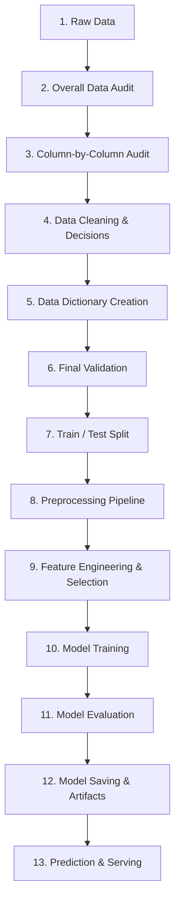

# Machine Learning Project Workflow Guide

This document details the recommended standard step-by-step ML development lifecycle used in this template.

---

### Phase 1: Exploration & Understanding (Notebooks)
1. **Raw Data Ingestion**: Place raw file in `data/raw/`. Treat as read-only.
2. **Overall Data Audit**: Determine shape, memory footprint, duplicate rows, global null counts.
3. **Column-by-Column Audit**: Audit dtype, cardinality, unique values, missing percentages, outliers.
4. **Data Cleaning Decisions**: Formulate strategies for outliers, nulls, duplicates, and invalid characters.
5. **Data Dictionary**: Document findings into [docs/data_dictionary.md](file:///docs/data_dictionary.md).

### Phase 2: Pipeline Engineering (src/ modules)
6. **Final Validation**: Ensure required schema, data types, and non-empty target column exist.
7. **Train/Test Split**: Split dataset *before* applying any transformations to prevent data leakage.
8. **Preprocessing Pipeline**: Build a scikit-learn `ColumnTransformer` with imputers, scalers, and encoders.
9. **Feature Engineering & Selection**: Create derived features, remove zero-variance and multi-collinear columns.

### Phase 3: Modeling & Evaluation
10. **Model Training**: Combine preprocessor and estimator into an end-to-end `Pipeline` and fit on train split.
11. **Model Evaluation**: Evaluate predictions on test split using metrics (Accuracy, F1, ROC-AUC, RMSE).
12. **Model Persistence**: Serialize complete pipeline into `models/model_pipeline.joblib`.
13. **Inference / Serving**: Load pipeline via [src/models/predict.py](file:///src/models/predict.py) for batch or real-time inference.
